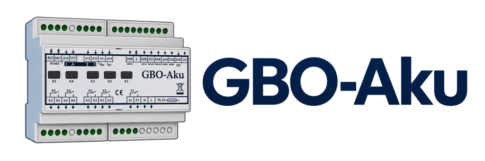

# GBO-Aku for Home Assistant

Local Home Assistant integration for the Yorix GreenBonO GBO-Aku energy controller via a Protoss PE11 Ethernet-to-RS485 gateway. It exposes live current, voltage, regulation and low-tariff data, RAM controls, communication diagnostics, and a configuration UI for verified EEPROM settings.

## Compatibility

- Reference hardware is the three-regulator GBO-Aku **3PI** running firmware **3.021**, with a Protoss **PE11**. Configuration behavior was verified against GreenBonO_HMI 3.0.3.0 and 3.0.3.6 during development. Other hardware and firmware are unverified.
- The release targets Home Assistant Core **2025.12 or later**. Local brand images are supported from Core 2026.3. The built-in Marketplace is available from Core 2026.11.
- The Home Assistant UI includes English and Czech translations.

## Configure the PE11

| Setting | Value |
| --- | --- |
| Protocol | `None` (transparent TCP) |
| Serial link | `9600` baud, 8 data bits, no parity, 1 stop bit |
| TCP port | `8899` by default |
| Modbus slave ID | `1` by default |

The gateway must forward raw Modbus RTU frames with their CRC intact. Disable Modbus TCP gateway mode on the PE11.

**Use one Modbus master at a time.** Close GreenBonO_HMI before adding the integration. To use HMI later, turn off **Communication enabled** on the GBO-Aku device in Home Assistant. This stops polling and closes the TCP connection. Close HMI before turning Home Assistant communication back on. The switch resets to enabled after an integration reload or Home Assistant restart.

## Install

On Home Assistant 2026.11 and later, open **Settings → Marketplace → Add from link**. Add `zodiaccz/ha-gbo-aku`, then install **GBO-Aku** from its repository page. Follow the GitHub connection prompt if needed. [Marketplace documentation](https://www.home-assistant.io/integrations/marketplace/#custom-repositories)

On versions using HACS, open **HACS → ⋮ → Custom repositories**. Add `https://github.com/zodiaccz/ha-gbo-aku` as an **Integration**, then download **GBO-Aku**. [HACS custom repositories](https://www.hacs.dev/docs/faq/custom_repositories/)

For a manual install, download `gbo_aku.zip` from the Releases page and extract it into `/config/custom_components/gbo_aku/`. Verify that `manifest.json` is directly inside that directory. [Release downloads](https://github.com/zodiaccz/ha-gbo-aku/releases)

After installation, restart Home Assistant. Open **Settings → Devices & services → Add integration → GBO-Aku**. Enter the PE11 address, TCP port and operational Modbus slave ID. The setup flow tests a read before saving. To upgrade a manual installation, replace the integration files, restart Home Assistant and keep the existing config entry.

## Controls and polling

- The **External control mode** select adjusts RAM and offers local/default regulation, regulation, all off and all on. The **Synchronize time** button also writes to RAM.
- By default, the integration polls live data every 1 second, RAM every 5 seconds and EEPROM every 300 seconds. Reads can reconnect and retry once. Entities retain their last values briefly and become unavailable after 15 seconds without a successful live read.
- Automatic clock sync is enabled by default. It checks every 60 minutes and writes the Home Assistant local time to RAM if the device clock is invalid or differs by more than 30 seconds. Change these defaults under **Configure → Communication and polling**.
- The **Low tariff** binary sensor reports the physical tariff input. Calculated SSR and cascade levels are estimates derived from controller data.

## EEPROM and FLASH

Use the integration's **Configure** menu for occasional changes to persistent settings. EEPROM has limited write endurance. Use the RAM controls for routine automation.

- **EEPROM: surplus outputs (BLACK)** sets surplus-regulation links for K1–K5 and SSR1–SSR6.
- **EEPROM: NT / timer outputs (RED)** sets low-tariff and timer links. SSR bit order is `1, 4, 2, 5, 3, 6`. The integration manages the HMI's auxiliary RED bits for SSR1, SSR4 and SSR2.
- **EEPROM: verified regulation settings** covers NT bypass, 1-second SSR cycle, Udc regulation enable and inversion, half-period modulation, EU daylight-saving time, stopping PI after dark, delayed regulation start, weekly night-consumption days, and K5 mode. Timer times, calibration, Modbus addressing and other unverified settings stay outside the write interface.

EEPROM Save reads the current words, preserves unrelated bits, writes the changed words and the `EEConfigWord`, commits with `0x55AA`, and verifies by reading back. The integration never automatically resends an EEPROM write after a failed response. If the status is uncertain, inspect the current configuration before attempting another save.

**FLASH: back up current configuration** replaces the controller's recovery copy only after you explicitly confirm. Use it after verifying that the current EEPROM configuration operates as intended. It copies the 128-byte EEPROM image, checks the controller's `P` → `p` completion status, resets the controller, reconnects, and compares the EEPROM with the original image. Expect a temporary interruption during reset. EEPROM Save leaves the FLASH recovery copy untouched. Use GreenBonO_HMI and the vendor's recovery process if recovery is needed.

## Support and license

Include your Home Assistant Core version, integration version, GBO-Aku firmware and relevant sanitized logs when filing an issue. [Project issue tracker](https://github.com/zodiaccz/ha-gbo-aku/issues)

The integration code and documentation are available under the [MIT License](LICENSE). Product names and marks belong to their respective owners. [Yorix product documentation](https://www.yorix.cz/cz/greenbono/gbo-aku.htm)
